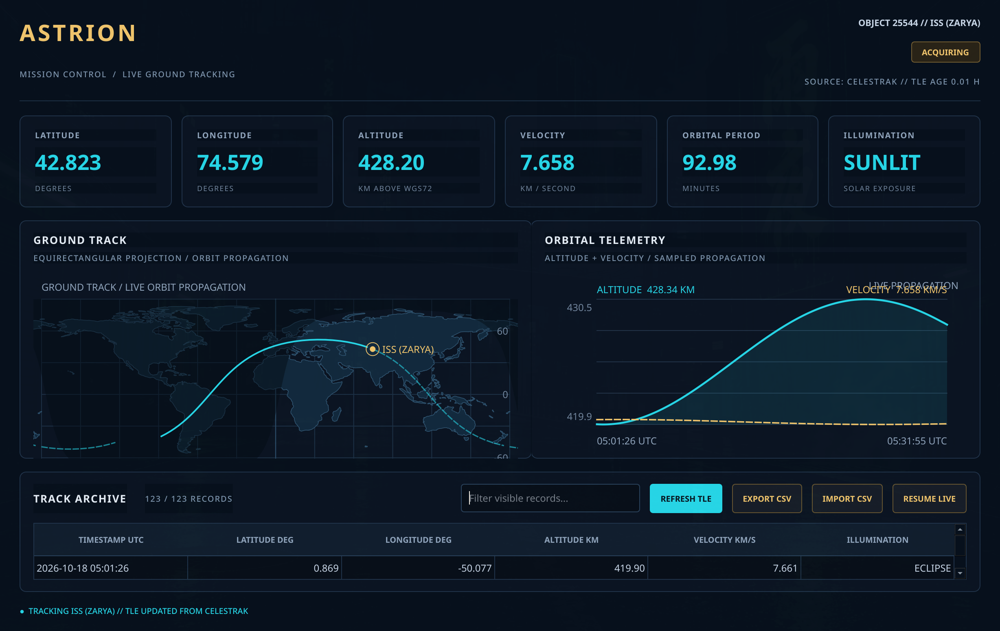

# ASTRION // Mission Control

ASTRION is an aerospace-inspired C++20 and Qt 6 desktop dashboard for
tracking a satellite with real SGP4 orbit propagation.

## Features

- Dark mission-control interface with cyan and gold accents
- Live ISS tracking via CelesTrak TLE elements, with offline cache
- SGP4 (WGS72) near-earth orbit propagation validated against reference vectors
- Equirectangular ground track with land outlines and day/night terminator
- Altitude and velocity trend chart of the sampled ground track
- Telemetry metric cards: latitude, longitude, altitude, velocity, period, illumination
- CSV import and export with input validation, plus archive review mode
- Searchable telemetry table with text filtering
- Automated tests: telemetry parser, TLE parser, and SGP4 golden-vector suite
- CMake build system

## Important limitation

ASTRION is a portfolio and learning project. It propagates published orbital
elements for visualization only. It does not connect to spacecraft, provide
flight-control functionality, command onboard systems, or represent NASA
software. Orbital accuracy depends entirely on the age and quality of the
imported TLE elements.

## Requirements

- C++20 compiler
- CMake 3.21 or newer
- Qt 6.4 or newer
- Qt 6 Widgets, Network, and Test modules
- Ninja (recommended)

On Arch Linux or Omarchy, install the required packages:

    sudo pacman -S --needed base-devel cmake ninja qt6-base

## Build

From the project root:

    cmake -S . -B build -G Ninja -DCMAKE_BUILD_TYPE=Release
    cmake --build build

## Run

    ./build/astrion

On startup ASTRION requests fresh ISS orbital elements from CelesTrak and
falls back to a local cache when offline. The REFRESH TLE button re-requests
elements at any time.

## Run tests

    ctest --test-dir build --output-on-failure

Three test suites run: telemetry CSV parsing, TLE parsing, and SGP4
propagation. The SGP4 suite compares propagated state vectors against
reference output from the authoritative `sgp4` Python implementation at
seven time offsets per case, including a decayed-object error case.

## Import sample telemetry

Use the IMPORT CSV button in the application and select:

    examples/sample-telemetry.csv

The supported CSV format is:

    timestamp,latitude_deg,longitude_deg,altitude_km,velocity_km_s,sunlit

Timestamps must use ISO 8601 format in UTC. Latitude must be within -90 to
90, longitude within -180 to 180, altitude must be non-negative, and
velocity must be positive. The sunlit field accepts 1/0, true/false, or
sunlit/eclipse.

Exported CSV files use the same format, so exports can be re-imported
without loss.

## Project layout

- src/main.cpp: application entry point
- src/mainwindow.hpp/.cpp: dashboard layout, archive mode, CSV import/export
- src/missioncontroller.hpp/.cpp: live tracking loop, ground track, history
- src/tlesource.hpp/.cpp: CelesTrak TLE fetch, parse, and disk cache
- src/sgp4.hpp/.cpp: SGP4 near-earth propagator (WGS72)
- src/tle.hpp/.cpp: two-line element parser
- src/astro.hpp/.cpp: time, frame transforms, geodetic conversion, sun geometry
- src/telemetry.hpp/.cpp: telemetry records and CSV parser
- src/plotwidget.hpp/.cpp: altitude and velocity trend chart
- src/orbitwidget.hpp/.cpp: ground track map and terminator display
- data/ne_110m_land.geojson: Natural Earth land outlines for the map
- tests/test_telemetry.cpp: CSV parser tests
- tests/test_tle.cpp: TLE parser tests
- tests/test_sgp4.cpp: SGP4 golden-vector and astro tests
- tests/golden/: reference state vectors from the sgp4 Python package
- examples/sample-telemetry.csv: sample ground track export
- docs/screenshot.png: application screenshot

## License

See LICENSE.
